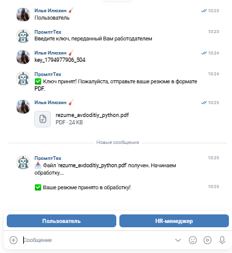
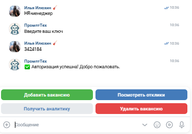
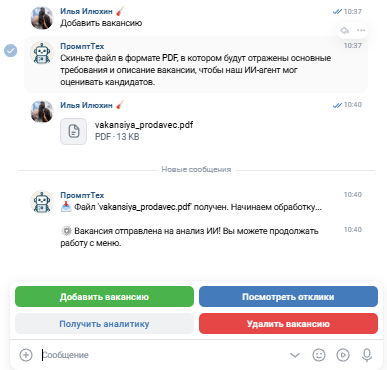
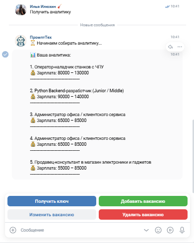
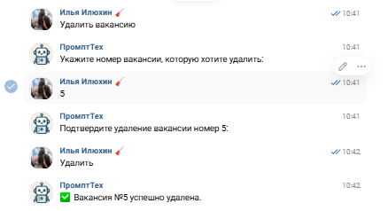
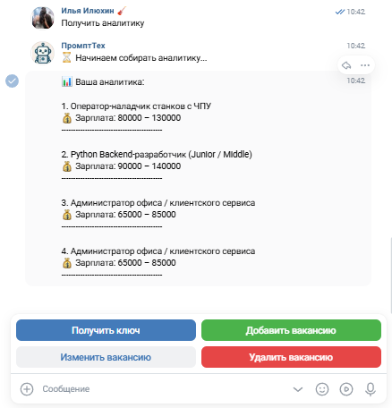
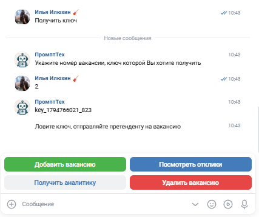
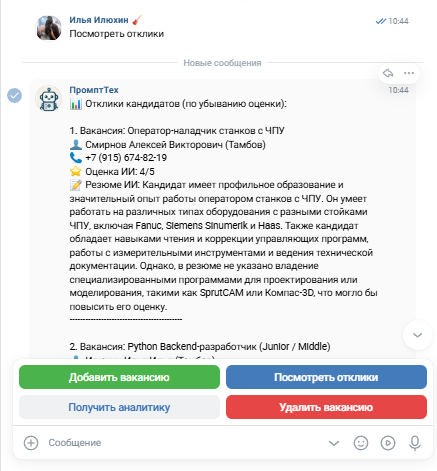
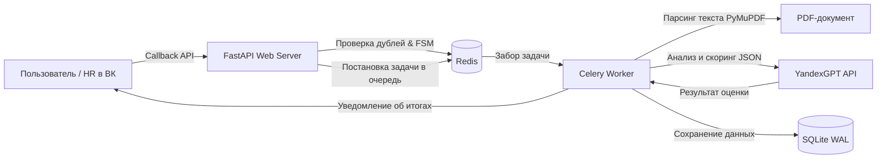

# HR-Assistant VK Bot

**15 минут на 40 резюме — реальность.**

Система автоматического скрининга резюме — интеллектуальный бот для ВКонтакте для первичного отбора кандидатов на базе **YandexGPT**.


## Бизнес-задача и ценность проекта
При массовом подборе персонала HR-менеджеры тратят часы на ручной разбор однотипных PDF-резюме, поиск контактов и первичную фильтрацию неподходящих откликов.

**HR-Assistant VK Bot решает эту проблему:**
* **Сокращает время ручного скрининга:** вместо чтения десятков страниц HR сразу получает структурированную выжимку по каждому кандидату (ФИО, город, телефон, ключевой опыт) и объективную оценку соответствия вакансии от 1 до 5.
* **Автоматизирует публикацию вакансий:** достаточно загрузить PDF-описание вакансии, и ИИ сам выделит зарплатную вилку, график работы и требования, сгенерировав уникальный ключ для откликов.
* **Ускоряет воронку найма:** соискатели отправляют резюме прямо в привычном интерфейсе ВКонтакте по ключу вакансии и мгновенно получают обратную связь о приеме отклика.

## Демонстрация работы

### 1. Выбор роли при старте
Пользователь или HR-менеджер выбирает свой сценарий работы в меню бота.


### 2. Отклик соискателя с PDF-резюме
Кандидат вводит ключ вакансии и загружает свое резюме в формате PDF.


### 3. Авторизация HR-менеджера
Вход в кабинет работодателя по персональному ключу доступа.


### 4. Добавление новой вакансии из PDF
HR отправляет PDF-описание вакансии, и задача мгновенно уходит в фоновую очередь Celery на анализ YandexGPT.


### 5. Сводная аналитика по активным вакансиям
Бот формирует список всех размещенных позиций с автоматически извлеченной зарплатной вилкой.


### 6. Удаление неактуальной вакансии
Управление списком вакансий с подтверждением действия.


### 7. Обновленная аналитика после удаления
Проверка актуального списка активных вакансий.


### 8. Получение уникального ключа для соискателей
Выдача ключа конкретной вакансии для отправки кандидатам.


### 9. Рейтинг кандидатов и скоринг от ИИ
HR получает отсортированный список откликов с контактами, оценкой соответствия от 1 до 5 и подробным комментарием YandexGPT.


## Протестировать бота вживую

Бот развернут на сервере и доступен для тестирования: **[Перейти в диалог с ботом ВКонтакте](https://vk.com)**

**Как быстро проверить работу (за 30 секунд):**
1. Выберите роль соискателя (откликнуться на вакансию).
2. Введите тестовый ключ существующей вакансии: `key_1794766021_823` (вводить нужно чистый текст без кавычек).
3. Отправьте любой PDF-файл с резюме (можете скачать тестовый пример из папки [`docs/sample_resume.pdf`](docs/sample_resume.pdf)).
4. Получите мгновенное подтверждение приема и автоматический анализ от YandexGPT.

## Архитектура и пайплайн обработки
Чтобы вебхук ВКонтакте отвечал мгновенно без таймаутов, тяжелая обработка PDF и запросы к LLM вынесены в асинхронную очередь фоновых задач:



## 🛠 Стек технологий
* **Backend:** Python 3.12, FastAPI, Uvicorn
* **Очереди и фоновые задачи:** Celery, Redis
* **ИИ и работа с документами:** YandexGPT (через LangChain), PyMuPDF (`fitz`)
* **База данных и хранилище состояний:** SQLite (`aiosqlite` + `sqlite3` в режиме WAL), Redis (FSM-состояния и защита от дублей событий через `SET NX`)
* **Интеграция:** VK Callback API (`httpx`)
* **Инфраструктура и деплой:** Docker, Docker Compose

## Ключевые инженерные решения
1. **Идемпотентность вебхуков:** FastAPI мгновенно отсекает повторные уведомления от ВК по `event_id` через атомарную проверку в Redis (`SET NX`), исключая дублирование откликов.
2. **Цепочки фоновых задач (`Celery Chain`):** скачивание PDF-файла, извлечение текста и LLM-инференс объединены в последовательный пайплайн в отдельном воркере, что защищает основной сервер от блокировок.
3. **Изоляция хранилищ в Docker:** настроены общие тома (`volumes`) между веб-сервером и воркером для безопасного обмена временными PDF-файлами и конкурентной работы с базой данных в режиме WAL.

## Быстрый запуск

### Способ 1. Через Docker Compose (рекомендуется)
1. Клонируйте репозиторий и перейдите в директорию проекта:
   ```bash
   git clone https://github.com/chivapshisch/hr-assistant-vk-bot
   cd hr-assistant-vk-bot
   ```
2. Создайте файл `.env` на основе `.env.example` и укажите ваши токены VK и Yandex Cloud:
   ```bash
   cp .env.example .env
   ```
3. Запустите все сервисы (`web`, `worker`, `redis`) в фоновом режиме:
   ```bash
   docker compose up -d --build
   ```

### Способ 2. Локальный запуск (без Docker)
1. Создайте и активируйте виртуальное окружение, установите зависимости:
   ```bash
   python -m venv venv
   venv\Scripts\activate
   pip install -r requirements.txt
   ```
2. Скопируйте `.env.example` в `.env` и заполните переменные окружения.
3. Запустите Redis, Celery-воркер и сервер FastAPI:
   ```bash
   celery -A parser_pdf.app worker --loglevel=info -P solo
   python main.py
   ```

## Планы по развитию (Roadmap)
* [ ] **Биллинговая система:** оплата HR-менеджером добавления вакансии.
* [ ] **Переход на PostgreSQL:** миграция с SQLite на PostgreSQL + SQLAlchemy + Alembic для масштабирования при высокой нагрузке.
* [ ] **Веб-интерфейс для HR:** разработка REST API и личного кабинета с фильтрацией кандидатов по оценке ИИ, сменой статусов и выгрузкой отчетов.
* [ ] **Сбор фидбека и Eval-метрики:** добавление кнопок оценки качества скоринга ИИ для сбора датасета и дообучения / оптимизации промптов.
* [ ] **CI/CD пайплайн:** настройка автотестов (`pytest`) и автоматического деплоя на сервер через GitHub Actions.
